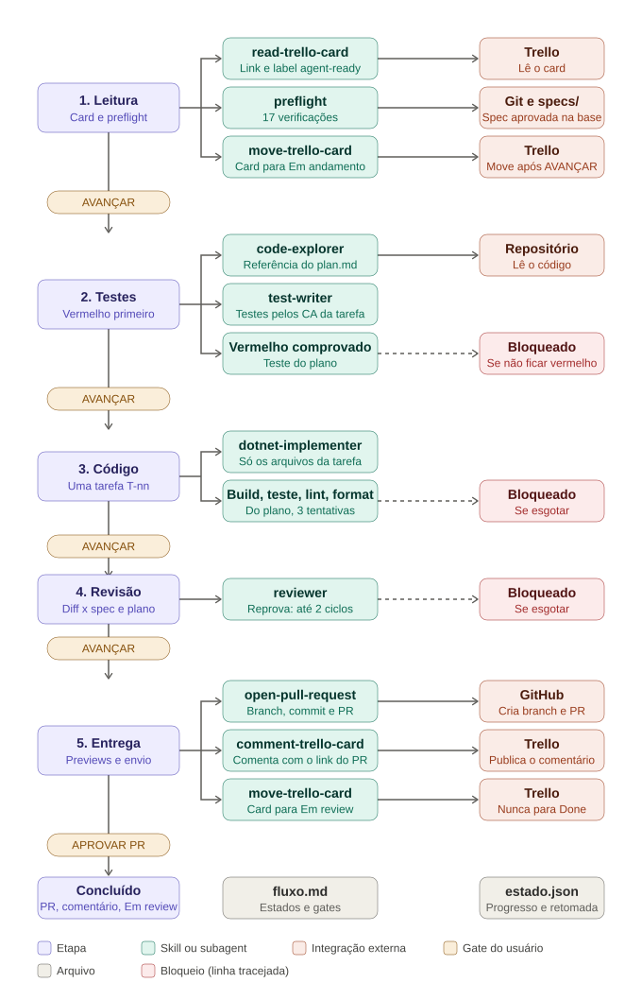

# Agente de Desenvolvimento (v2)

Só codifica. Recebe o link de um card do Trello que já passou pelo agente de especificação, lê `specs/<card-id>-<slug>/{spec,plan,tasks}.md` na branch base e implementa UMA tarefa (`T-nn`) por execução e por PR: valida o ambiente, escreve os testes pelos critérios de aceite (vermelho primeiro), implementa até ficar verde, roda build, teste, lint e format do plano, revisa o diff e abre o PR. Roda no Claude Code. Fica entre o agente de especificação (spec aprovada e card com a label `agent-ready` em Especificado) e o agente de revisão (que revisa o PR).

## Fluxo



O fluxo é uma máquina de estados definida em `resources/fluxo.md`. O gate de usuário de cada passagem é:

| Etapa | O que acontece | Usa | Gate |
|---|---|---|---|
| 1 Leitura e validação | Lê o card (link e label `agent-ready`), roda o preflight (spec aprovada e mergeada, card em Especificado, tarefa livre, comandos do plano, ambiente, linha de base) e mostra o preview de mover o card para Em andamento | `read-trello-card`, `move-trello-card` | AVANÇAR (move o card) |
| 2 Testes | Lê o código de referência do plano, escreve os testes pelos critérios da tarefa e comprova o vermelho | `code-explorer`, `test-writer` | AVANÇAR |
| 3 Código | Implementa só os arquivos da tarefa; loop de build, teste, lint e format do plano (3 tentativas); documentação listada | `dotnet-implementer` | AVANÇAR |
| 4 Revisão | Confere o diff com spec, plano e tarefa (2 ciclos) | `reviewer` | AVANÇAR |
| 5 Entrega | Preview do PR, do comentário e do movimento para Em review | `open-pull-request`, `comment-trello-card`, `move-trello-card` | APROVAR PR |

O card só entra se estiver na lista Especificado com a label `agent-ready`. A spec precisa estar com `Status: aprovada` na base. O agente nunca deduz o que a spec, o plano ou a tarefa não trazem: para e oferece comentar no card (COMENTAR). Marcar a tarefa como concluída em `tasks.md` e mover o card para Done são do time, após o merge.

## Flexibilidade

| Quero | Faço |
|---|---|
| Tirar uma aprovação manual | Em `resources/fluxo.md`, troque o gate da transição por `auto` (rode os evals antes) |
| Incluir ou remover um estado | Edite as tabelas Estados e Transições |
| Incluir uma verificação inicial | Acrescente a linha em `resources/preflight.md` |

O `AGENTS.md` não muda. Valem sempre as guardas: preflight, vermelho antes do código, limites de tentativa, escopo de escrita (só os arquivos da tarefa) e regras de git. A revisão e o merge do PR continuam humanos. Não usa Graphite.

## Como usar

1. Abra o Claude Code na **raiz do repositório da spec**, limpo e na branch base, com o PR da spec já mergeado.
2. Disponibilize este agente nesse repositório: copie (ou aponte por link simbólico) `.claude/agents/`, rode `install.sh` do kit para instalar as skills (`read-trello-card`, `comment-trello-card`, `open-pull-request`, `move-trello-card`), e importe `AGENTS.md` no `CLAUDE.md` do repositório (`@caminho/AGENTS.md`). Mantenha `resources/` ao lado do `AGENTS.md`.
3. Conecte por MCP o Trello e deixe a CLI `gh` autenticada.
4. Diga: `Implementa este card: <link>` e, se quiser, `tarefa T-02`. Sem a tarefa, o agente propõe a próxima cuja dependência está concluída.
5. Responda cada gate que o agente pedir. Para outra tarefa do mesmo card, faça uma nova execução depois do merge da anterior.
6. Adicione `estado.json` ao `.gitignore` do repositório (uma vez). O agente o cria e atualiza sozinho, e retoma a sessão por ele.

## Estrutura

```
AGENTS.md          orquestrador: motor genérico e ações dos estados
CLAUDE.md          aponta para AGENTS.md
resources/         fluxo.md (estados, transições, gates), preflight.md,
                   convencoes.md, ajuda.md
evals/casos.md     casos de teste
docs/fluxo.svg     diagrama do fluxo
.claude/agents/    code-explorer, test-writer, dotnet-implementer, reviewer
```

Skill é capacidade e funciona sozinha; o processo mora só em `AGENTS.md` e `resources/`. Novas stacks entram como outro implementer (por exemplo `frontend-implementer`), sem mudar o resto.

## Antes de usar em produção

- Restrinja `tools` dos agents às ferramentas necessárias; o `reviewer` e o `code-explorer` são somente leitura.
- Proteja `main` e `develop` no GitHub (branch protection) e exija revisão humana no PR: o agente não faz merge, mas a regra no servidor é a garantia.
- Rode `evals/casos.md`, em especial os críticos listados lá.
- Comece por uma tarefa pequena de uma spec já mergeada.
