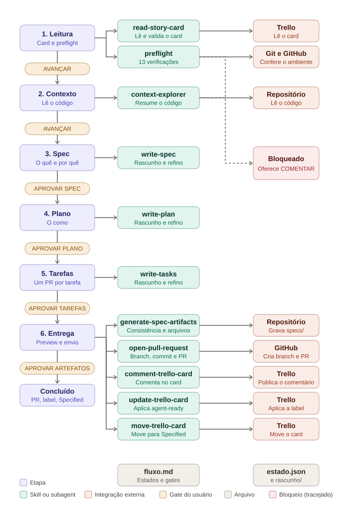

# Agente de Especificação (v1)

Recebe o link de um card do Trello (já refinado em linguagem de negócio) e conduz a especificação técnica com Spec-Driven Development: refina com você a spec, o plano e as tarefas e, com a sua aprovação, entrega `spec.md`, `plan.md` e `tasks.md` por PR. Roda no Claude Code. Fica entre o agente de refinamento e o agente de desenvolvimento.

```
Refinamento (negócio) -> Especificação (este) -> Desenvolvimento (só código) -> Revisão
```

## Fluxo



O fluxo é uma máquina de estados definida em `resources/fluxo.md`. Todo avanço é manual:

| Etapa | O que acontece | Usa | Gate |
|---|---|---|---|
| 1 Leitura e validação | Lê o card, confere se está completo e roda o preflight | `read-story-card` | AVANÇAR |
| 2 Contexto | Lê o código e os guias do repositório, incluindo `specs/constitution.md` se existir | `context-explorer` | AVANÇAR |
| 3 Spec | Rascunho do quê e porquê; você refina | `write-spec` | APROVAR SPEC |
| 4 Plano | Rascunho do como; você refina | `write-plan` | APROVAR PLANO |
| 5 Tarefas | Fatias do tamanho de um PR; você refina | `write-tasks` | APROVAR TAREFAS |
| 6 Entrega | Preview; depois grava, abre o PR, comenta, aplica a label e move o card para `Especificado` | `generate-spec-artifacts`, `open-pull-request`, `comment-trello-card`, `update-trello-card`, `move-trello-card` | APROVAR ARTEFATOS |

Com `APROVAR ARTEFATOS`, o card termina na lista `Especificado` (último passo, depois da label). Se o repositório tem `specs/constitution.md`, as regras `CONST-nnn` são citadas na spec, no plano e nas tarefas.

O agente nunca deduz o que o card, o código ou você não trouxeram: vira `a definir` e o gate não libera enquanto houver pendência. VOLTAR retorna uma etapa e invalida as aprovações seguintes.

## O que sai

```
specs/<card-id>-<slug>/
  spec.md     requisitos (RF) e critérios de aceite (CA), sem tecnologia
  plan.md     decisões (DT), componentes, contrato, testes, comandos, rollout
  tasks.md    tarefas (T) do tamanho de um PR, com os arquivos de cada uma
```

Formato e rastreabilidade em `resources/estrutura-specs.md`. Sinal de "pronto para codificar": `Status: aprovada` nos arquivos e a label `agent-ready` no card. A spec só vale depois do merge do PR.

## Flexibilidade

| Quero | Faço |
|---|---|
| Aprovar spec, plano e tarefas de uma vez | Em `resources/fluxo.md`, troque o gate de T7 e T8 por `auto` |
| Incluir ou remover um estado | Edite as tabelas Estados e Transições |
| Incluir uma verificação inicial | Acrescente a linha em `resources/preflight.md` |

O `AGENTS.md` não muda. Valem sempre as guardas: preflight, escopo de escrita, não deduzir e regras de git.

## Como usar

1. Abra o Claude Code na **raiz do repositório do card**, limpo e na branch base.
2. Disponibilize este agente no repositório: copie `.claude/agents/` e `.claude/skills/`, rode `install.sh` do kit para as skills compartilhadas (`read-story-card`, `update-trello-card`, `comment-trello-card`, `move-trello-card`, `open-pull-request`) e importe `AGENTS.md` no `CLAUDE.md` do repositório (`@caminho/AGENTS.md`). Mantenha `resources/` ao lado do `AGENTS.md`.
3. Conecte por MCP o Trello (o board precisa ter a lista `Especificado`) e deixe a CLI `gh` autenticada.
4. Adicione `estado.json` e `rascunho/` ao `.gitignore` do repositório (uma vez).
5. Diga: `Especifica este card: <link>, repositório <org/repo>, base <branch>`.
6. Responda cada gate que o agente pedir.

## Estrutura

```
AGENTS.md          orquestrador: motor genérico e ações dos estados
CLAUDE.md          aponta para AGENTS.md
resources/         fluxo.md, preflight.md, convencoes.md, estrutura-specs.md, ajuda.md
evals/casos.md     casos de teste
docs/fluxo.svg     diagrama do fluxo
.claude/agents/    context-explorer
.claude/skills/    write-spec, write-plan, write-tasks, generate-spec-artifacts
                   (cada uma: SKILL.md e references/)
```

Skill é capacidade e funciona sozinha; o processo mora só em `AGENTS.md` e `resources/`.

## Observações

- `comment-trello-card`, `move-trello-card` e `open-pull-request` (compartilhadas com o agente de desenvolvimento) vivem em `skills/trello` e `skills/git`; `update-trello-card` e `read-story-card` vivem em `skills/trello`. Todas são instaladas por `install.sh`.
- `read-story-card` e `context-explorer` têm nome próprio para não colidir com `read-trello-card` e `code-explorer` do agente de desenvolvimento, que têm contrato diferente.
- Sem Graphite: o PR dos artefatos é um PR comum, aberto com git e `gh`.

## Antes de usar em produção

- Restrinja `tools` do `context-explorer` à leitura.
- Proteja `main` e `develop` no GitHub (branch protection) e exija revisão humana no PR.
- Rode `evals/casos.md`, em especial os críticos listados lá.
- Comece por uma story pequena.
