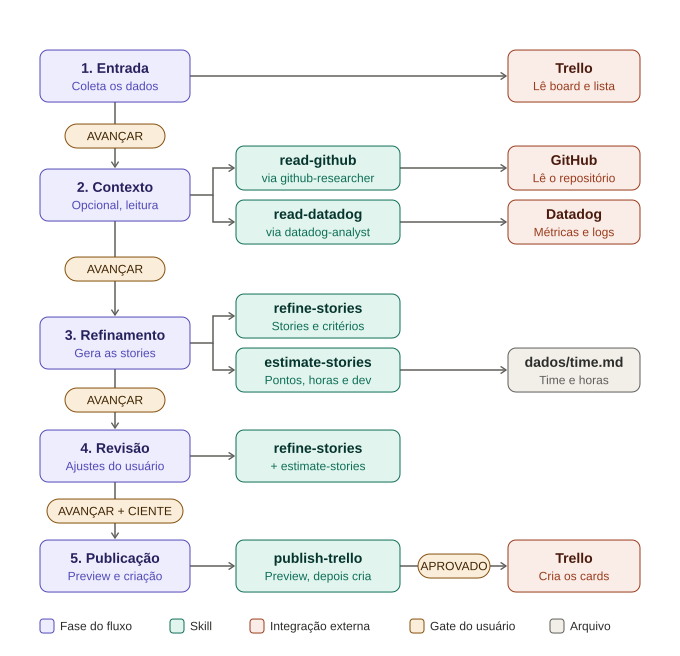

# Agente de Refinamento Scrum (v4)

Conduz o refinamento de histórias em 5 fases e cria os cards no Trello. Contexto técnico opcional (GitHub e Datadog). Roda no Claude Code e no GitHub Copilot.

## Fluxo



| Fase | O que acontece | Gate |
|---|---|---|
| 1 Entrada | Você informa objetivo, problema, persona, escopo, board e lista | AVANÇAR |
| 2 Contexto | Opcional. Lê repositório e métricas; você aceita ou recusa cada sugestão | AVANÇAR |
| 3 Refinamento | Gera stories, estima pontos e horas, sugere dev | AVANÇAR |
| 4 Revisão | Você ajusta stories, dev, pontos e ordem | AVANÇAR (CIENTE se houver carga) |
| 5 Publicação | Preview dos cards; só cria depois da sua aprovação | APROVADO |

O agente nunca deduz dado que você não informou. Em qualquer fase, diga **ajuda**.

## Cards prontos para codificar

Story de código leva a **especificação técnica dentro do card**: repositório, referência de implementação (arquivo:linha), contrato, regras, arquivos a alterar, testes e comandos, restrições. Cada item tem fonte; o que falta fica `a definir`. A story só recebe a label `agent-ready` quando está completa e confirmada por você (CONV-017). Assim, no futuro, um agent de desenvolvimento lê apenas o link do card.

## Como usar

1. Preencha `dados/time.md` (capacidade e horas) e `dados/fontes.md` (API, repositório, serviço).
2. Conecte por MCP: Trello (obrigatório), GitHub e Datadog (só para contexto).
3. Abra a pasta na raiz no Claude Code e inicie a conversa.
4. Informe os campos da Fase 1 e responda cada gate (AVANÇAR, CIENTE, APROVADO).
5. Confira o resultado no board.

Entrada mínima:

```
Objetivo:
Problema:
Persona:
Escopo:
Fora de escopo:
Board:
Lista de destino:
Contexto técnico (opcional): API, fontes (GitHub, Datadog) e a pergunta
```

## Estrutura

```
AGENTS.md          orquestrador: fases, gates, ligação entre skills
CLAUDE.md          aponta para AGENTS.md
resources/         convencoes.md, relatorio-contexto.md, ajuda.md
dados/             time.md, fontes.md
evals/casos.md     casos de teste
docs/fluxo.svg     diagrama do fluxo
.claude/skills/    read-github, read-datadog, estimate-stories, refine-stories, publish-trello (cada uma: SKILL.md e references/examples.md, references/report.md)
.claude/agents/    github-researcher, datadog-analyst
```

Skill é capacidade e funciona sozinha; o processo mora só no `AGENTS.md`.

## GitHub Copilot

- **VS Code:** lê `AGENTS.md` (habilite `chat.useAgentsMdFile`), `.claude/skills/` e `.claude/agents/`. Configure o MCP do Trello nele.
- **CLI:** copie os agents para `.github/agents/*.agent.md`. Sem a cópia, a Fase 2 roda as skills na conversa.

## Testes

Rode `evals/casos.md` a cada mudança e a cada modelo. Críticos: 31 (não deduzir), 26 e 27 (confirmação antes de escrever).
