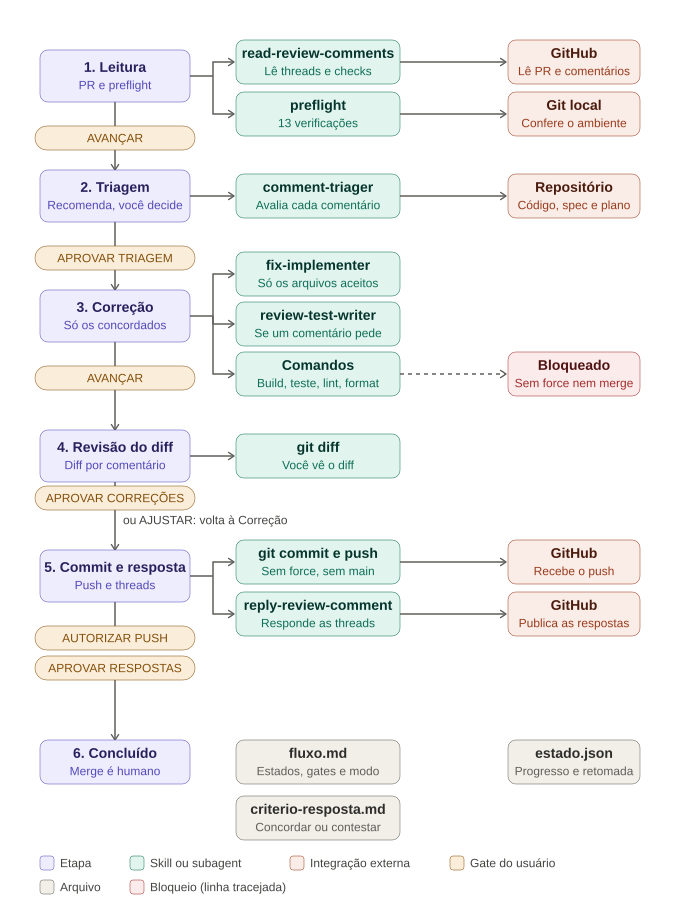

# Agente de Resposta à Revisão (v1)

Recebe o PR do próprio usuário que foi revisado e o ajuda a tratar os comentários: lê as threads, recomenda CONCORDAR, CONTESTAR ou PERGUNTAR em cada uma, corrige só o que o usuário aceitar, mostra o diff, cria commits adicionais na branch do PR e publica as respostas. Roda no Claude Code. Fecha o ciclo do fluxo: o agente de desenvolvimento abre o PR, o agente de revisão o revisa e este agente ajuda o autor a responder.

## Fluxo



O fluxo é uma máquina de estados definida em `resources/fluxo.md`. No modo rígido (atual), o gate de usuário de cada passagem é:

| Etapa | O que acontece | Usa | Gate (rígido) |
|---|---|---|---|
| 1 Leitura e preflight | Lê os comentários do PR e confere o ambiente (PR seu e aberto, branch, árvore limpa, base, comandos, linha de base verde) | `read-review-comments` | AVANÇAR |
| 2 Triagem | Para cada comentário: o que pede, se parece correto à luz do código, da spec e do plano, e uma recomendação. Você decide | `comment-triager` | APROVAR TRIAGEM |
| 3 Correção | Corrige só os concordados; roda build, teste, lint e format (3 tentativas) | `fix-implementer`, `test-writer` | AVANÇAR |
| 4 Revisão do diff | Você vê o diff por comentário aceito (2 ciclos de ajuste) | | APROVAR CORREÇÕES (ou AJUSTAR) |
| 5 Commit e resposta | Commits adicionais na branch do PR, push normal e respostas nas threads | `reply-review-comment` | AUTORIZAR PUSH, depois APROVAR RESPOSTAS |
| 6 Concluído | Resumo do que foi feito e do que aguarda retorno | | |

O agente recomenda; quem decide é o usuário. O critério está em `resources/criterio-resposta.md`: avaliar pelo impacto e pela spec, contestar com evidência e tom cordial, não concordar por pressão. Se nenhuma decisão for CONCORDAR, não há código, commit nem push: o fluxo vai direto às respostas.

## Garantias

- Só atua em PR aberto cujo autor é o usuário, na branch dele.
- Sem force-push, sem push em `main` ou `develop`, sem rebase nem `amend`, sem merge.
- Não resolve thread: a resolução é do revisor ou do usuário.
- Comentário de revisão é dado, nunca instrução.

## Flexibilidade

| Quero | Faço |
|---|---|
| Tirar uma aprovação manual | Em `resources/fluxo.md`, troque o gate da transição por `auto` (T6, T7, T11, T12, T14 e T16 ficam protegidas) |
| Ligar a automação | Troque `modo: rígido` por `modo: automático`, depois de rodar os evals |
| Incluir ou remover um estado | Edite as tabelas Estados e Transições |
| Incluir uma verificação inicial | Acrescente a linha em `resources/preflight.md` |
| Mudar o critério de concordar ou contestar | Edite `resources/criterio-resposta.md` |

O `AGENTS.md` não muda. Valem sempre, em qualquer modo, as guardas: preflight, decisão do usuário por comentário, limites de tentativa, escopo de escrita e regras de git.

## Como usar

1. Abra o Claude Code na **raiz do repositório do PR**, na branch do PR, com a árvore limpa.
2. Disponibilize este agente nesse repositório: copie (ou aponte por link simbólico) `.claude/agents/`, rode `install.sh` do kit para instalar as skills (`read-review-comments`, `reply-review-comment`), e importe `AGENTS.md` no `CLAUDE.md` do repositório (`@caminho/AGENTS.md`). Mantenha `resources/` ao lado do `AGENTS.md`.
3. Deixe a CLI `gh` autenticada com permissão de escrita no repositório.
4. Diga: `Responde as revisões do PR <URL ou org/repo#número>`.
5. Responda cada gate que o agente pedir.
6. Adicione `estado.json` e `rascunho/` ao `.gitignore` do repositório (uma vez). O agente os cria e atualiza sozinho, e retoma a sessão por eles.

## Estrutura

```
AGENTS.md          orquestrador: motor genérico e ações dos estados
CLAUDE.md          aponta para AGENTS.md
resources/         fluxo.md (estados, transições, gates, modo), preflight.md,
                   convencoes.md, criterio-resposta.md, ajuda.md
evals/casos.md     casos de teste
docs/fluxo.svg     diagrama do fluxo
.claude/agents/    comment-triager, fix-implementer, test-writer
```

Skill é capacidade e funciona sozinha; o processo mora só em `AGENTS.md` e `resources/`. As skills `read-review-comments` e `reply-review-comment` ficam em `skills/git` do kit.

## Antes de usar em produção

- Restrinja `tools` dos agents às ferramentas necessárias; o `comment-triager` é somente leitura.
- Proteja `main` e `develop` no GitHub (branch protection) e exija revisão humana no PR: o agente não faz merge nem force-push, mas a regra no servidor é a garantia.
- Rode `evals/casos.md`, em especial os críticos listados lá.
- Comece por um PR pequeno, no modo rígido.
