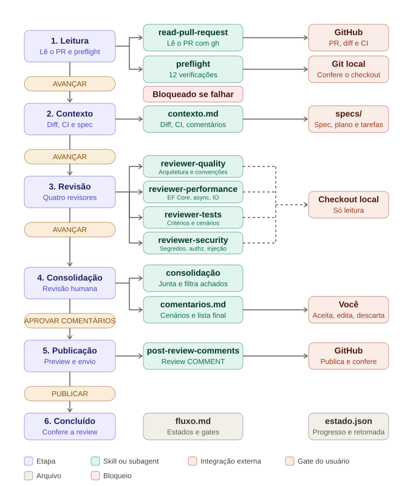

# Agente de Revisão (v1)

Recebe a URL de um Pull Request, lê o PR, valida o ambiente, reúne o contexto (diff, CI, spec do card), roda quatro revisores em paralelo e consolida os achados em comentários que você aceita, edita ou descarta antes de publicar uma review no GitHub. Roda no Claude Code. Complementa o agente de desenvolvimento, que abre os PRs, e antecede o agente de resposta à revisão.

**A revisão do PR continua sendo sua.** O agente apoia: aponta achados e lista os cenários de teste a conferir. Ele não altera código, não aprova, não pede mudanças, não faz merge e não move card. A review que ele publica é sempre do tipo `COMMENT`.

## Fluxo



O fluxo é uma máquina de estados definida em `resources/fluxo.md`. O gate de usuário de cada passagem é:

| Etapa | O que acontece | Usa | Gate |
|---|---|---|---|
| 1 Leitura e preflight | Lê o PR e confere o ambiente (PR aberto, checkout no head, árvore limpa, CI visível, spec do card em `specs/`) | `read-pull-request` | AVANÇAR |
| 2 Contexto | Junta diff, CI, comentários existentes, spec, plano e tarefas | | AVANÇAR |
| 3 Revisão automática | Quatro revisores em paralelo, só leitura | `reviewer-quality`, `reviewer-performance`, `reviewer-tests`, `reviewer-security` | AVANÇAR |
| 4 Consolidação e revisão humana | Junta achados, lista os cenários de teste a conferir e os comentários propostos; você aceita, edita ou descarta | | APROVAR COMENTÁRIOS |
| 5 Publicação | Preview da review (`COMMENT`) e publicação | `post-review-comments` | PUBLICAR |
| 6 Concluído | Confere que os comentários foram publicados e resume | | |

Os revisores:

| Revisor | Foco |
|---|---|
| `reviewer-quality` | Clean Architecture e DDD, legibilidade, convenções do repositório e aderência à spec |
| `reviewer-performance` | Consultas EF Core e N+1, alocações, async/await, IO |
| `reviewer-tests` | Cobertura dos critérios de aceite, cenários, nomes por comportamento, testes frágeis, xUnit, Moq, Shouldly |
| `reviewer-security` | Segredos, dados pessoais em log, validação de entrada, autenticação e autorização, injeção, dependências |

Cada achado traz severidade (`BLOQUEANTE`, `IMPORTANTE` ou `SUGESTAO`), `arquivo:linha`, evidência curta e sugestão curta. Achado sem local e evidência é descartado.

## Flexibilidade

| Quero | Faço |
|---|---|
| Tirar uma aprovação manual | Em `resources/fluxo.md`, troque o gate da transição por `auto` |
| Incluir ou remover um estado | Edite as tabelas Estados e Transições |
| Incluir uma verificação inicial | Acrescente a linha em `resources/preflight.md` |
| Incluir um revisor | Crie o arquivo em `.claude/agents/` e acrescente-o à etapa 3 em `resources/fluxo.md` |

O `AGENTS.md` não muda. Valem sempre, em qualquer configuração, as guardas: preflight, escopo de escrita, evento `COMMENT`, bloqueio de dado protegido e regras de git. Mantenha APROVAR COMENTÁRIOS e PUBLICAR como gates de usuário.

## Como usar

1. Abra o Claude Code na **raiz do repositório do PR**, com o checkout no head do PR (`gh pr checkout <número>`) e a árvore limpa. Os revisores leem os arquivos desse checkout.
2. Disponibilize este agente nesse repositório: copie (ou aponte por link simbólico) `.claude/agents/`, rode `install.sh` do kit para instalar as skills (`read-pull-request`, `post-review-comments`), e importe `AGENTS.md` no `CLAUDE.md` do repositório (`@caminho/AGENTS.md`). Mantenha `resources/` ao lado do `AGENTS.md`.
3. Deixe a CLI `gh` autenticada.
4. Diga: `Revisa este PR: <URL>`.
5. Responda cada gate que o agente pedir. Na etapa 4, revise você mesmo o PR e use a lista de cenários de teste.
6. Adicione `estado.json` e `rascunho/` ao `.gitignore` do repositório (uma vez). O agente os cria e atualiza sozinho, e retoma a sessão por eles.

## Estrutura

```
AGENTS.md          orquestrador: motor genérico e ações dos estados
CLAUDE.md          aponta para AGENTS.md
resources/         fluxo.md (estados, transições, gates), preflight.md,
                   convencoes.md, ajuda.md
evals/casos.md     casos de teste
docs/fluxo.svg     diagrama do fluxo
.claude/agents/    reviewer-quality, reviewer-performance, reviewer-tests, reviewer-security
```

Skill é capacidade e funciona sozinha; o processo mora só em `AGENTS.md` e `resources/`.

## Antes de usar em produção

- Os revisores são somente leitura (`Read`, `Grep`, `Glob`); não amplie as ferramentas deles.
- Proteja `main` e `develop` no GitHub (branch protection) e exija aprovação humana no PR: o agente nunca aprova nem faz merge, mas a regra no servidor é a garantia.
- Rode `evals/casos.md`, em especial os críticos listados lá.
- Comece por um PR pequeno.
